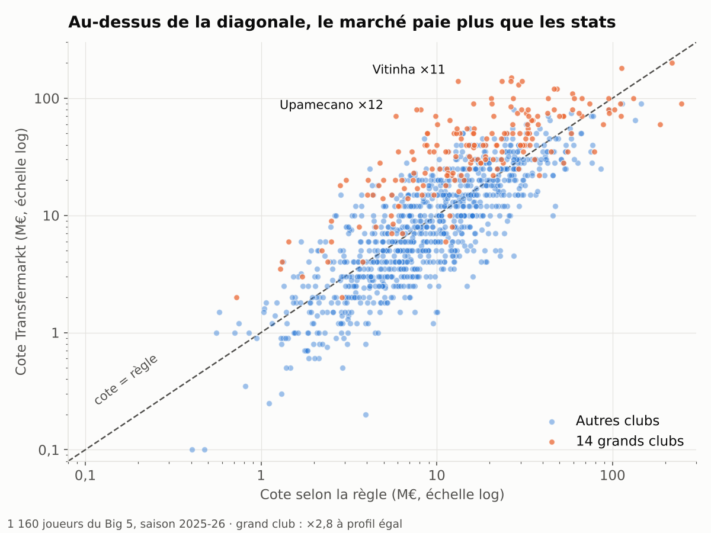
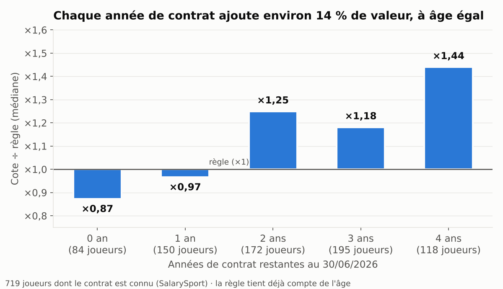

# Combien vaut vraiment un joueur ? Valorisation des joueurs du Big 5 (2025-26)

**Un outil d'aide à la décision pour une cellule de recrutement : il estime ce qu'un joueur « devrait » valoir d'après ses performances, et repère ceux que le marché paie trop cher ou pas assez.**

Python (pandas, scikit-learn, web scraping) · SQL · Power BI · 1 160 joueurs des 5 grands championnats européens



---

## La question

Un directeur sportif de club du Big 5, hors très grands clubs, prépare son mercato avec un budget limité. Il lui faut des réponses à trois questions :

1. **Acheter** : quels joueurs ont un rendement sur le terrain supérieur à ce que coûte leur cote ?
2. **Négocier** : quand un vendeur annonce un prix, quelle part vient des performances et quelle part vient d'autre chose (le maillot, le contrat, l'image) ?
3. **Vendre** : à quel moment vendre un joueur pour en tirer le meilleur prix ?

## La démarche en une phrase

Une régression linéaire apprend, sur 1 160 joueurs, **combien le marché paie en moyenne** les performances, l'âge, le poste et le championnat : c'est la « règle ». On compare ensuite la cote réelle de chaque joueur à cette règle :

> **Marché ÷ règle** : ×1 = payé comme un profil moyen comme le sien ; ×3 = payé trois fois plus ; ×0,3 = trois fois moins.

## Résultats

| | Résultat |
|---|---|
| Ce qu'explique la règle | **64 %** des écarts de cote (R² en validation croisée sur 5 blocs ; forêt aléatoire : 61 %) |
| Championnat | Premier League : **×2,6** à profil égal |
| Âge | **−17 %** de cote par année |
| Stats qui comptent | xA (+30 % pour +0,1 par 90 min), buts (+21 %), interceptions (+25 % pour +1 par 90 min) ; les tacles, non |
| Grand club | **×2,8** à profil égal ; le R² passe de 64 % à 73 % en l'ajoutant |
| Contrat restant | **+14 % par année**, à âge égal (×0,87 pour un contrat qui se termine en juin 2026, ×0,97 à 1 an, ×1,44 à 4 ans) |
| Instagram (panel de 100) | le tiers le plus suivi est à **×1,7** la règle, le moins suivi à **×0,6** |



## Recommandations

**Lire les écarts avec la bonne marge.** La règle se trompe en moyenne d'un facteur 1,6. Un joueur à ×0,8 ou ×1,3 est donc dans la norme. Seuls les écarts au-delà de **×0,5 ou ×2** (31 % des joueurs) sont des signaux.

### 1. Acheter : une liste de 16 joueurs à visionner en priorité

Filtre : 25 ans ou moins, au moins 1 800 minutes jouées, hors grand club, cote inférieure à la moitié de la règle. Sur 1 160 joueurs, **16 sortent**. Les 8 premiers :

| Joueur | Poste | Club | Âge | Cote | Règle | Marché ÷ règle |
|---|---|---|---|---|---|---|
| Filippo Terracciano | Déf. | Cremonese | 23 | 4,5 M€ | 27,5 M€ | ×0,16 |
| Danilo Veiga | Déf. | Lecce | 23 | 2,5 M€ | 14,9 M€ | ×0,17 |
| Samuele Angori | Mil. | Pisa | 22 | 4,5 M€ | 22,9 M€ | ×0,20 |
| Arijon Ibrahimović | Mil. | Heidenheim | 20 | 10,0 M€ | 45,7 M€ | ×0,22 |
| Hugo Bueno | Déf. | Wolverhampton | 23 | 12,0 M€ | 47,4 M€ | ×0,25 |
| Jonathan Fischer | Gard. | Metz | 24 | 2,0 M€ | 7,0 M€ | ×0,29 |
| Gift Orban | Att. | Hellas Verona | 23 | 7,0 M€ | 24,2 M€ | ×0,29 |
| Louis Mouton | Mil. | Angers | 24 | 4,0 M€ | 12,6 M€ | ×0,32 |

Ce n'est pas une liste d'achats. C'est **une liste de joueurs à faire visionner** : la règle voit les statistiques, pas le niveau tactique, les blessures ou le profil. Les trois listes complètes sont produites à la fin du notebook (partie « Recommandations »).

### 2. Négocier : isoler la part « maillot »

À profil égal, un joueur de grand club vaut **2,8 fois** la règle. Face à un vendeur de grand club, la règle donne le prix des performances. L'écart avec le prix demandé, c'est ce qu'on paie pour le nom du club, et c'est là que se négocie la remise.

Hors grand club, un écart de plus de **×3** doit être justifié avant d'aller plus loin : une image, un profil rare ou une concurrence entre acheteurs. Exemples : Éderson (Atalanta, ×5,3), Manu Koné (Roma, ×3,6), Castello Lukeba (Leipzig, ×3,6).

### 3. Vendre : prolonger avant de vendre

À âge et performances égaux, un joueur à **1 an de contrat** vaut ×0,97 la règle, contre **×1,44 à 4 ans**. Vendre un joueur à un an de la fin de son contrat, c'est accepter **environ un tiers de moins**. La règle d'action : prolonger un joueur qu'on compte vendre **avant qu'il n'entre dans sa dernière année de contrat** (×1,25 à 2 ans, ×0,97 à 1 an).

À l'inverse, à l'achat, **28 titulaires (1 800 minutes ou plus) de 27 ans ou moins** sont à un an ou moins de la fin de leur contrat. Leur club vendeur est en position de faiblesse.

## Méthode

```
FBref (stats 2025-26)     ─┐
Transfermarkt (cotes)     ─┼─► nettoyage + jointures (Python) ─► règle (régression) ─► écarts
SalarySport (scraping)    ─┤                                              │
Instagram (panel manuel)  ─┘                                   SQL (MySQL) · Power BI (7 pages)
```

1. **Collecte**
   - Statistiques FBref de 8 championnats ; on garde le Big 5.
   - Cotes Transfermarkt (jeu de données public [Football Data from Transfermarkt](https://www.kaggle.com/datasets/davidcariboo/player-scores), CC0).
   - Salaires et fins de contrat **scrapés** sur SalarySport avec `requests` et `BeautifulSoup` : 5 pages, 6 276 lignes, 1 980 joueurs du Big 5, journal de chaque étape.
   - Abonnés Instagram de 100 joueurs relevés à la main le 15/09/2026.
2. **Préparation**
   - Big 5, poste connu, 900 minutes jouées ou plus : 1 422 joueurs.
   - Statistiques ramenées à 90 minutes.
   - Jointure sans identifiant commun, sur nom normalisé + championnat + poste : 1 160 joueurs (82 %).
3. **Modèle**
   - Régression linéaire sur le log de la cote, avec 16 variables : 7 statistiques par 90 minutes, l'âge, les minutes, le poste et le championnat.
   - Validation croisée sur 5 blocs mélangés, et comparaison avec une forêt aléatoire.
4. **Facteurs hors règle** testés un par un : grand club, contrat, salaire, Instagram. On les garde hors de la règle pour que les écarts restent visibles.
5. **SQL**
   - 4 tables en étoile : joueurs, salaires, postes, ligues.
   - Jointures, `RANK()` par championnat, et médianes recalculées avec `ROW_NUMBER()` : on retrouve les mêmes chiffres qu'en Python.
6. **Power BI** : 7 pages (Cadre, Marché, Règle, Écarts, Club & contrat, Instagram, Fiche joueur), avec des filtres championnat et poste.

## Choix et difficultés

| Difficulté | Solution |
|---|---|
| Pas d'identifiant commun FBref / Transfermarkt (104 ids en commun) | Jointure sur nom normalisé (`unicodedata`) + championnat + poste : 82 % retrouvés, et les joueurs perdus ont une cote proche des autres |
| Salaires sans API | Scraper `requests` + `BeautifulSoup` : nouvelles tentatives automatiques, pause entre les pages, journal |
| Accents cassés au scraping (« München ») | Encodage UTF-8 forcé + fonction de réparation |
| Cotes de 0,1 à 200 M€ | Modèle sur le log : effets lus en %, stars non dominantes |
| Fichier trié par championnat | Validation croisée sur blocs **mélangés** |
| La forêt aléatoire apprend par cœur (0,83 en entraînement, 0,56 en test) | Régression gardée : meilleure sur des joueurs non vus et lisible |
| Effet du contrat mêlé à l'âge | Mesuré sur l'écart à la règle, qui tient déjà compte de l'âge |
| Salaire trop lié à la cote (R² 0,81) | Gardé hors modèle : il reflète la cote plus qu'il ne l'explique |
| Panel plus large ? | Testé sur 8 championnats (fin du notebook) : R² 0,68, mais gagné par la seule variable ligue (0,36 sans elle). Le Big 5 est un marché plus homogène |

## Limites

- **Jointures sur le nom** : 18 % des joueurs perdus côté Transfermarkt, 38 % côté salaires.
- Les **cotes Transfermarkt et les salaires SalarySport sont des estimations**, pas des montants de transferts réels.
- Les contrats qui finissent après 2030 manquent.
- Le **panel Instagram** est petit, choisi à la main et relevé une seule fois : on ne peut pas dire si les abonnés font le prix.
- Une seule saison de statistiques : pas de blessures, pas de forme récente.

**Pistes** : un rapprochement approximatif des noms, plusieurs saisons pour prédire la cote de la saison suivante, et des données d'image (sponsors, réseaux sociaux) relevées dans le temps.

## Contenu du dépôt et reproduction

| Fichier | Contenu |
|---|---|
| `Sources - Python/valorisation_joueurs.ipynb` | Notebook complet, exécuté, commenté étape par étape |
| `Sources - Python/scraping_salarysport.log` | Journal du scraping SalarySport (07/10/2026) |
| `Sources - Python/panel_insta_100 .csv` | Panel Instagram brut |
| `Sources - Python/joueurs_modele.csv`, `joueurs_clean.csv` | Résultats exportés par le notebook (pour SQL et Power BI) |
| `sql/valorisation.sql` | Script SQL (tables, jointures, classements, médianes) |
| `powerbi/valorisation_joueurs.pbix` | Rapport Power BI |

```bash
pip install pandas numpy matplotlib seaborn scikit-learn requests beautifulsoup4
```

**Les données brutes ne sont pas dans ce dépôt** : les statistiques FBref, les fichiers Transfermarkt et les salaires SalarySport restent soumis aux conditions de leurs sources (voir [CADRE_JURIDIQUE.md](CADRE_JURIDIQUE.md)). Le notebook est publié exécuté : tous les résultats y sont lisibles sans le relancer.

Pour le relancer :

1. Télécharger `players.csv`, `clubs.csv` et `player_valuations.csv` depuis le [jeu de données Kaggle](https://www.kaggle.com/datasets/davidcariboo/player-scores) et les placer dans `Sources - Python/Transfermarket/` ; exporter depuis FBref les statistiques 2025-26 des joueurs (`all_player_stats.csv`, `all_player_profiles.csv`) dans `Sources - Python/Fbref/`, en respectant les [conditions de Sports Reference](https://www.sports-reference.com/data_use.html).
2. Ouvrir `Sources - Python/valorisation_joueurs.ipynb`, puis **Kernel → Restart & Run All**.
3. Les salaires SalarySport ne sont pas republiés : sans relevé local, les parties sur le salaire ne se relancent pas (leurs résultats restent visibles dans le notebook exécuté).

## Cadre juridique

Ce que le droit explique dans les résultats (contrat, arrêt Bosman, arrêt Diarra, image, mineurs) et dans quel cadre les données ont été utilisées (RGPD, bases de données, scraping) : voir [CADRE_JURIDIQUE.md](CADRE_JURIDIQUE.md).

---

Justine Meignen · Data Analyst, formation initiale en droit du sport
